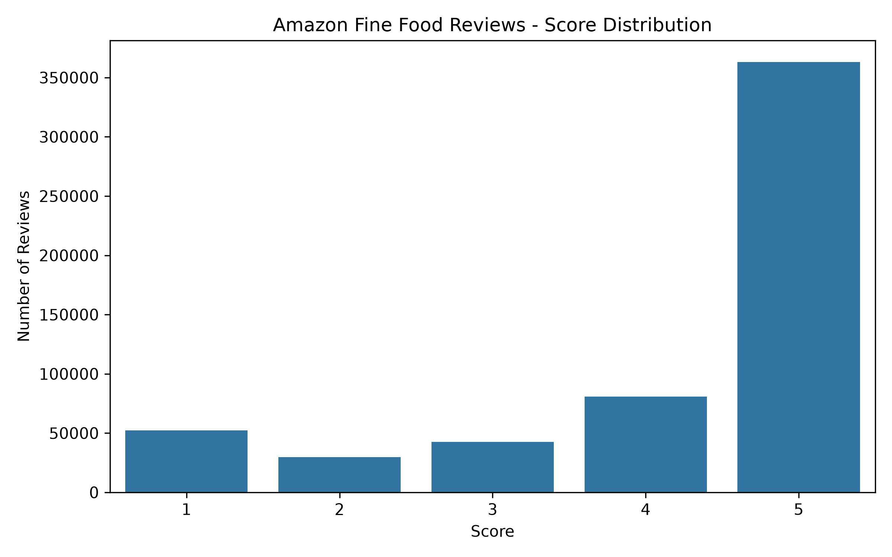
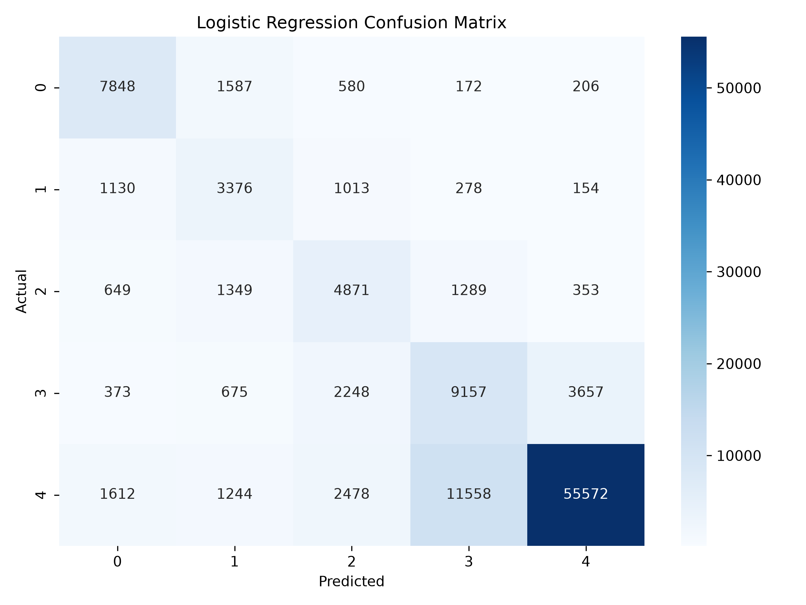
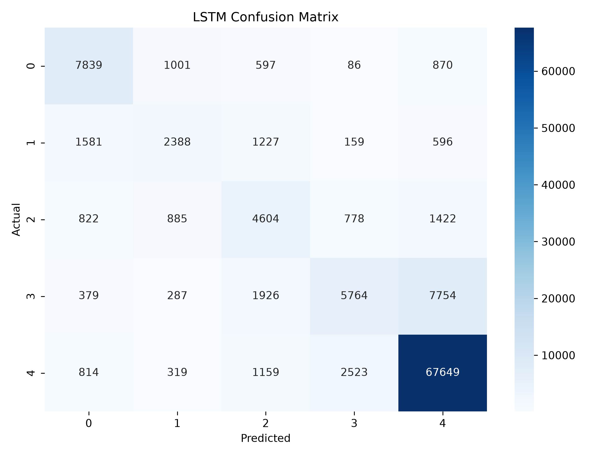
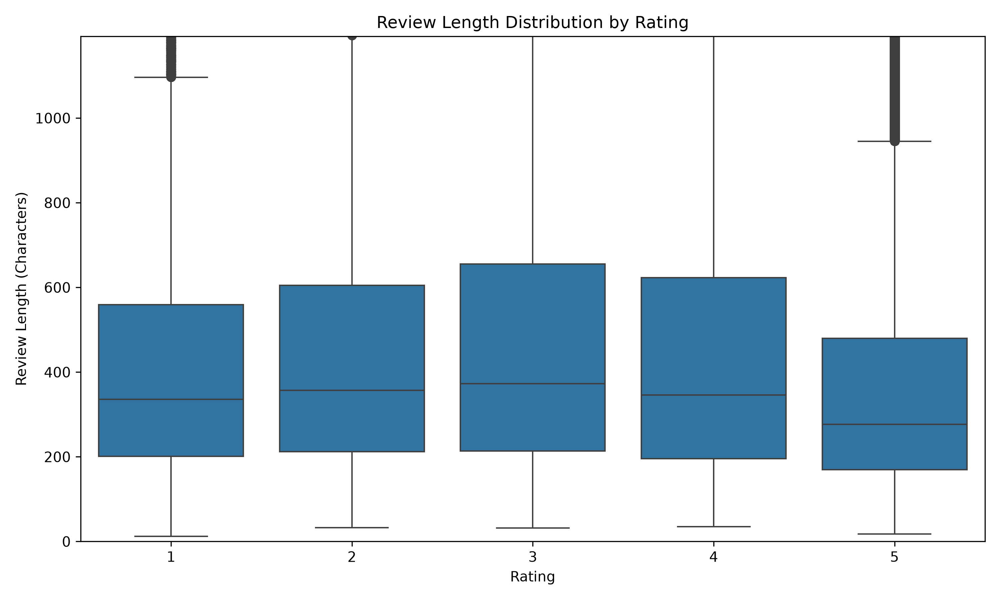

# Amazon Review Sentiment Classification

A five-class sentiment classification project on Amazon Fine Food Reviews, comparing traditional machine learning with deep learning approaches.

## 1. Project Overview

This project explores sentiment classification of Amazon food product reviews using two approaches:

- **TF-IDF + Logistic Regression**: A traditional machine learning baseline.
- **Embedding + LSTM**: A deep learning model for sequential text classification.

The task is to predict a review's rating from its text, assigning one of five classes (1–5 stars).

The project covers data exploration, preprocessing, model training, evaluation, error analysis, and feature interpretation.

## 2. Dataset

**Amazon Fine Food Reviews**

- Source: [Kaggle - Amazon Fine Food Reviews](https://www.kaggle.com/datasets/snap/amazon-fine-food-reviews)
- Cleaned dataset size: 567,145 reviews
- Target variable: `Score`
- Classification task: Five-class classification (1–5 stars)

### Rating Distribution

| Rating | Number of Reviews |
|---|---:|
| 1 star | 51,965 |
| 2 stars | 29,753 |
| 3 stars | 42,558 |
| 4 stars | 80,550 |
| 5 stars | 362,319 |

The dataset is notably imbalanced, with 5-star reviews accounting for approximately 63.89% of the cleaned data.

## 3. Methodology

### Data Preprocessing

The preprocessing pipeline includes:

- Removing records with missing review text or ratings.
- Removing empty review texts.
- Removing duplicate reviews based on `UserId`, `ProductId`, and `Text`.
- Converting ratings to integer labels.

### Model 1: TF-IDF + Logistic Regression

TF-IDF is used to transform review text into numerical feature vectors.

Key parameters:

| Parameter | Value |
|---|---|
| max_features | 20,000 |
| ngram_range | (1, 2) |
| min_df | 3 |
| max_df | 0.95 |
| sublinear_tf | True |
| max_iter | 1,000 |
| class_weight | balanced |

### Model 2: Embedding + LSTM

A neural network based on word embeddings and LSTM is used to capture sequential information in review text.

Architecture:

`Embedding → LSTM → Dropout → Dense (Softmax)`

Key parameters:

| Parameter | Value |
|---|---|
| Vocabulary size | 20,000 |
| Maximum sequence length | 100 |
| Embedding dimension | 128 |
| LSTM units | 64 |
| Dropout | 0.3 |
| Optimizer | Adam |
| Epochs | 5 |
| Batch size | 256 |

## 4. Experimental Results

Both models were evaluated using the same 80/20 train-test split, with stratified sampling and `random_state=42`.

| Metric | Logistic Regression | LSTM |
|---|---:|---:|
| Accuracy | 71.26% | **77.80%** |
| Macro F1 | 59.96% | **60.42%** |
| Weighted F1 | 73.11% | **76.50%** |

LSTM achieved higher overall accuracy and weighted F1. However, its Macro F1 improvement was relatively small.

This indicates that the improvement was not uniform across all rating classes.


### Rating Distribution



### Confusion Matrices

The following confusion matrices illustrate the prediction performance of the two models across five rating classes.

| Logistic Regression | LSTM |
|---|---|
|  |  |

### Review Length Analysis




### Error Analysis

The confusion matrices reveal different prediction tendencies:

- LSTM identifies more 5-star reviews, with a 5-star recall of 93.4%, compared with 76.7% for Logistic Regression.
- LSTM also produces more false-positive 5-star predictions, with 5-star precision of 86.4%, compared with 92.7% for Logistic Regression.
- Logistic Regression performs better on recall for several minority rating classes, particularly 2-star and 4-star reviews.

These findings highlight the impact of class imbalance and the limitations of using accuracy alone to evaluate a multi-class classifier.

## 5. Feature Analysis

The project also investigates the relationship between review characteristics and model predictions.

Analysis includes:

- Review length distribution across rating classes.
- Top 15 influential text features for each rating class, extracted from Logistic Regression coefficients.
- Interpretation of discriminative words and phrases.

## 6. Project Structure

```text
amazon-review-sentiment-classification/
├── README.md
├── requirements.txt
├── .gitignore
├── data/
│   ├── raw/
│   └── processed/
├── notebooks/
│   ├── 01_data_exploration.ipynb
│   ├── 02_data_preprocessing.ipynb
│   ├── 03_logistic_regression.ipynb
│   ├── 04_lstm.ipynb
│   └── 05_feature_analysis.ipynb
├── src/
│   ├── data_loader.py
│   ├── preprocessing.py
│   ├── feature_extraction.py
│   ├── evaluation.py
│   └── models/
├── results/
│   ├── figures/
│   └── metrics/
└── tests/
```

## 7. Environment Setup

Recommended Python version: Python 3.12.

Create and activate a virtual environment:

```bash
python -m venv .venv
```

Install dependencies:

```bash
pip install -r requirements.txt
```

Start Jupyter:

```bash
jupyter notebook
```

## 8. Reproducing the Experiments

1. Download the Amazon Fine Food Reviews dataset from Kaggle.
2. Place `Reviews.csv` in `data/raw/`.
3. Run the notebooks in numerical order, from `01` to `05`.
4. Review generated figures and metrics in the `results/` directory.

The raw and processed datasets, as well as trained model files, are excluded from version control.

## 9. Limitations and Future Improvements

Current limitations include:

- Significant class imbalance, especially the dominance of 5-star reviews.
- Relatively weak classification performance on some minority rating classes.
- Limited model tuning and experimentation.

Potential improvements:

- Explore more effective class balancing strategies.
- Experiment with BiLSTM and attention mechanisms.
- Compare with pretrained language models such as BERT.
- Perform more detailed error analysis and hyperparameter tuning.

## 10. License

This project is intended for educational and experimental purposes.